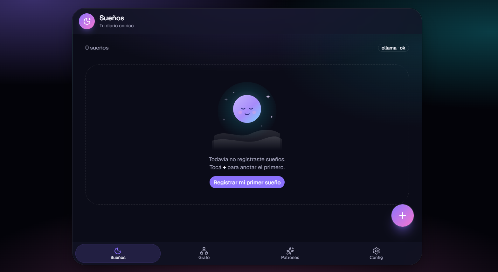
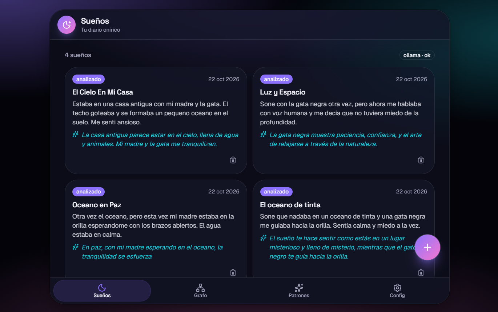
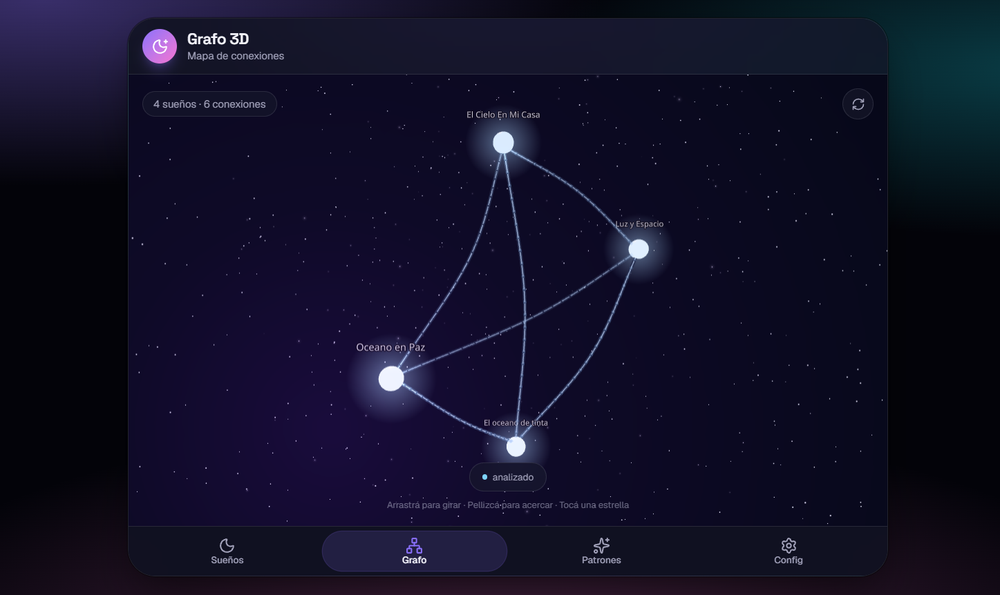
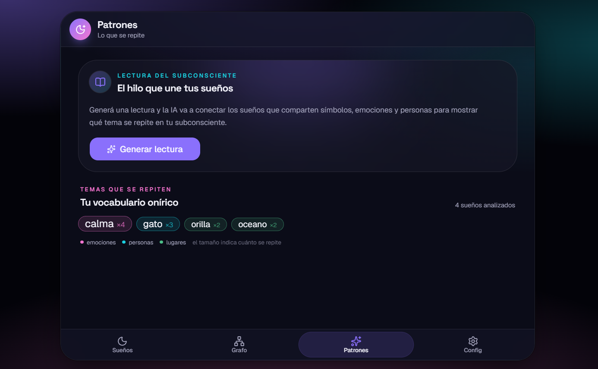
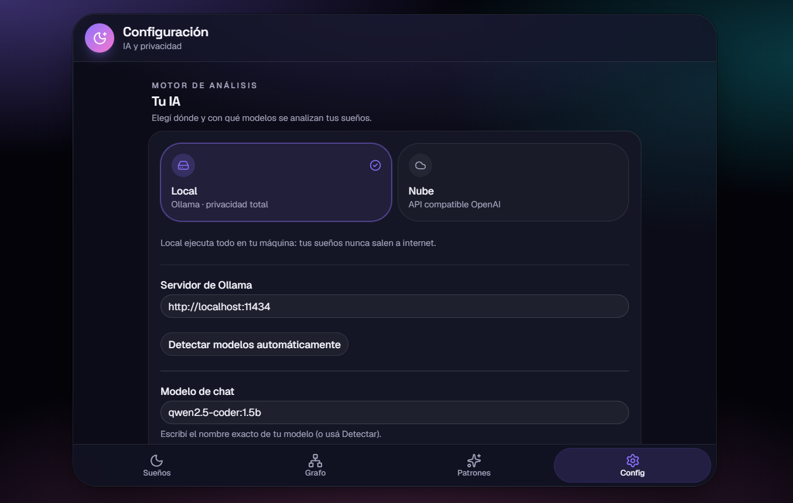

# 🌙 DreamScape

<div align="center">

[](https://github.com/MarceloAdan73/DreamScape/actions/workflows/ci.yml)


**🌙 Dream journal with local AI analysis — 100% private by default**

[✨ Features](#-features) • [🛠️ Installation](#-installation) • [🐳 Docker](#-docker-recommended) • [📖 Architecture](#-architecture) • [🧪 Testing](#-testing) • [🔮 Roadmap](#-roadmap)

</div>

---

## 🌟 Why DreamScape?

| Feature | Description |
|---------|-------------|
| 🎯 **Local AI** | Dream analysis runs on YOUR machine with Ollama — no cloud, no subscriptions |
| 🔒 **Privacy first** | Dreams are intimate: DB + vectors live in `backend/data/`, never committed |
| 🕸️ **3D Graph** | Dreams linked by shared entities + semantic similarity, rendered with Three.js |
| 🧠 **Patterns** | Recurring symbols, emotions, people & places ranked by frequency + AI reading |
| 🤖 **Dual provider** | Ollama (default) or any OpenAI-compatible API as an *explicit* fallback |
| 🧪 **Tested** | 46 backend tests + ruff + mypy strict + oxlint + tsc, all in CI |
| 🐳 **Docker** | Full stack in one command: `docker compose up -d --build` |

---

## 📸 Screenshots

| Mobile | Desktop | 3D Graph | Patterns | Settings |
|--------|---------|----------|----------|----------|
|  |  |  |  |  |

---

## ✨ Features

### 📝 Core
- ✅ Dream log with title, mood & analysis status
- ✅ Text entry (20k chars) with instant title generation
- ✅ Automatic background analysis — poll status until done
- ✅ One-line insight per dream, extraction of symbols, emotions, people & places
- ✅ Re-analyze failed dreams, delete with confirmation

### 🕸️ Visualization
- ✅ **3D force graph** connecting dreams via shared entities & similarity (R3F)
- ✅ **Pattern cloud** — vocabulary sized by frequency, color-coded by type
- ✅ **Reading of the subconscious** — LLM-written narrative across your dreams

### 🔍 Similarity
- ✅ ChromaDB embedded index (cosine) — "which past dream is like this one?"
- ✅ Configurable threshold & top-K

### ⚙️ Settings from the UI
- ✅ Provider switch: **Local (Ollama)** ↔ **Cloud (OpenAI-compatible)**
- ✅ Model pickers fed by the real models installed on your machine
- ✅ API key stored in `backend/data/runtime.json` — **never returned to the client** (only `openai_api_key_set: true/false`)
- ✅ Full data wipe (irreversible, typed confirmation required)

---

## 🛠️ Installation

### 📋 Requirements
- Python 3.11+ / Node.js 18+
- [Ollama](https://ollama.com) with chat + embedding models:

```bash
ollama pull llama3.1:8b
ollama pull nomic-embed-text
```

> Without Ollama the app still runs: you can log & browse dreams, analysis stays `failed` and can be retried later.

### 🔧 Local setup

```bash
# 1. Clone
git clone https://github.com/MarceloAdan73/DreamScape.git
cd DreamScape

# 2. Backend
cd backend
python -m venv .venv
# Windows
.venv\Scripts\activate
# macOS/Linux
source .venv/bin/activate
pip install -e ".[dev,ai]"
uvicorn app.main:app --reload --port 8000

# 3. Frontend (new terminal)
cd frontend
npm install
npm run dev
# App: http://localhost:5173  (proxies /api to the backend)
```

### 🐳 Docker (Recommended)

```bash
docker compose up -d --build
```

| Service | URL |
|---------|-----|
| 🎨 **App** | http://localhost:8080 |
| 🔌 **API (direct)** | http://localhost:8001 |
| 💾 **Data** | `./backend/data` (bind mount) |

> The backend reaches **your** Ollama on the host via `host.docker.internal:11434` — same GPU, same models.
> SQLite + ChromaDB live in `./backend/data` and survive `docker compose down`.

---

## ⚙️ Configuration

Copy `.env.example` to `.env` (never commit the real one):

| Variable | Default | Description |
|----------|---------|-------------|
| `LLM_PROVIDER` | `ollama` | `ollama` (local) or `openai` (compatible API) |
| `OLLAMA_BASE_URL` | `http://localhost:11434` | Local Ollama endpoint |
| `OLLAMA_CHAT_MODEL` | `llama3.1:8b` | Analysis model |
| `OLLAMA_EMBED_MODEL` | `nomic-embed-text` | Embeddings model |
| `OPENAI_API_KEY` | — | Only if `LLM_PROVIDER=openai` |
| `SIMILARITY_THRESHOLD` | `0.45` | Max distance for "similar" dreams |

Precedence: **UI settings (runtime) > env vars**. The API key can also be set from the Settings screen.

---

## 📖 Architecture

```
  Frontend (React 19 + Vite + TS + Tailwind v4 + shadcn/ui + R3F)
        │  REST /api  (typed fetch)
        ▼
  Backend (FastAPI + SQLAlchemy 2 async + Pydantic v2)
        │
        ├── SQLite async (aiosqlite)         →  data/dreamscape.db
        ├── ChromaDB embedded (persistent)   →  data/chroma/
        └── LLMProvider (single interface)
              ├── Ollama  (local, default)   →  llama3.1:8b + nomic-embed-text
              └── OpenAI-compatible (explicit fallback)
```

<details>
<summary><b>📂 Click to expand project structure</b></summary>

```
DreamScape/
├── backend/
│   ├── app/
│   │   ├── api/            # dreams, analysis, settings routers
│   │   ├── core/           # config, LLM provider (dual), runtime store
│   │   ├── models/         # SQLAlchemy async models
│   │   ├── schemas/        # Pydantic v2 schemas
│   │   └── services/       # extractor, analyzer, graph, patterns, similarity
│   ├── tests/              # 46 tests (API, extractor, e2e analysis, fakes)
│   ├── Dockerfile
│   └── pyproject.toml      # ruff + mypy strict + pytest
├── frontend/
│   ├── src/
│   │   ├── components/     # views + shadcn/ui + app shell
│   │   └── lib/            # typed api client, types, nav
│   ├── nginx.conf          # static + /api proxy
│   └── Dockerfile          # multi-stage build → nginx
├── .github/workflows/ci.yml
├── docker-compose.yml
└── README.md
```

</details>

---

## 🧪 Testing

```bash
# Backend (from backend/)
pytest                # 46 tests
ruff check .          # lint
mypy app              # strict typing

# Frontend (from frontend/)
npm run lint          # oxlint
npm run build         # tsc + vite build
```

### 📊 Quality Metrics

| Metric | Value | Status |
|--------|-------|--------|
| Backend tests | 46/46 |  |
| Ruff | 0 errors |  |
| mypy (strict) | 0 errors |  |
| TypeScript | 0 errors |  |
| CI | GitHub Actions |  |

All checks also run in CI on every push and pull request.

---

## 🔮 Roadmap

- [x] Phase 1 — Backend core: config, models, CRUD, tests
- [x] Phase 2 — AI layer: dual LLMProvider, extractor, similarity, async analysis
- [x] Phase 3 — 3D graph + patterns + subconscious reading
- [x] Docker: compose + multi-stage images + nginx proxy
- [ ] Phase 4 — Monthly letter from the subconscious
- [ ] Phase 5 — Mobile app with its own identity
- [ ] Voice dream entry

---

## 🤝 Contributing

```bash
# 1. Fork
# 2. Create branch
git checkout -b feature/new-feature

# 3. Commit
git commit -am 'Add new feature'

# 4. Push
git push origin feature/new-feature

# 5. Pull Request
```

---

## 📄 License

MIT License — see [LICENSE](LICENSE)

---

## 👨‍💻 Author

**Marcelo Adán** — Full-Stack Developer

[](https://github.com/MarceloAdan73)
[](https://linkedin.com/in/marcelo-adan-palma)
[](https://nodoweb.digital)

> 🧠 **Architected by Marcelo Adán**
> "Code orchestrated by me with AI support as a development tool, maintaining professional standards and architectural decisions typical of a Full-Stack developer."

---

## 🙏 Acknowledgements

- [FastAPI](https://fastapi.tiangolo.com/) — REST API framework
- [SQLAlchemy](https://www.sqlalchemy.org/) — async ORM
- [Ollama](https://ollama.com/) — local AI inference
- [ChromaDB](https://www.trychroma.com/) — embedded vector store
- [React Three Fiber](https://docs.pmnd.rs/react-three-fiber/) — 3D graph
- [shadcn/ui](https://ui.shadcn.com/) — UI components
- [Tailwind CSS](https://tailwindcss.com/) — styling

---

<div align="center">

⭐ **If you like the project, give it a star!**

Made with ❤️ by Marcelo Adán | © 2026 DreamScape

</div>
